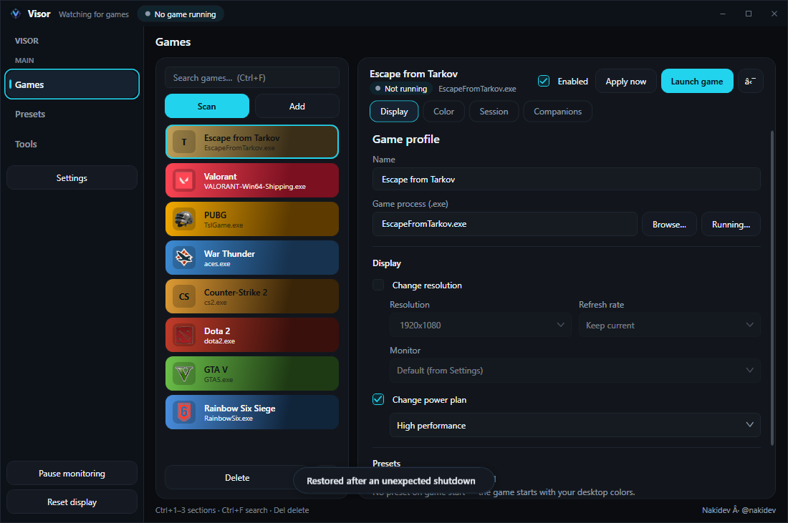
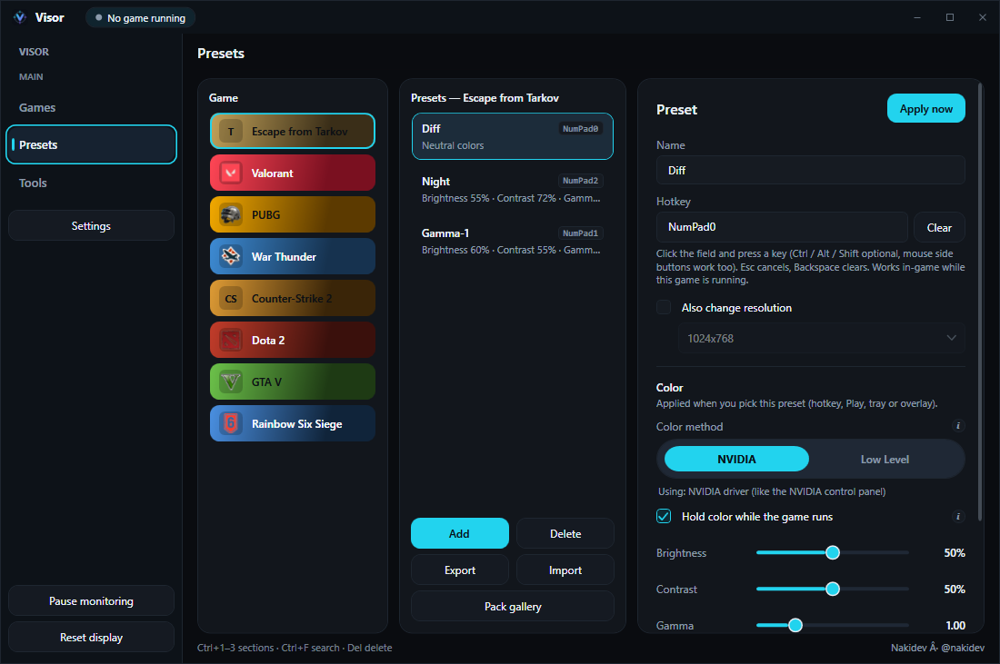

<p align="center">
  
</p>

<h1 align="center">Visor</h1>

<p align="center">
  <strong>Per-game display profiles for Windows.</strong><br>
  Resolution, refresh rate, power plan and color switch automatically when a game starts,<br>
  and everything is restored when it exits.
</p>

<p align="center">
  <a href="https://github.com/Naki-404/DisplayProfileManager/releases/latest"></a>
  <a href="https://github.com/Naki-404/DisplayProfileManager/releases/latest"></a>
  
  
  
</p>

<p align="center">
  <a href="#download">Download</a> ·
  <a href="#features">Features</a> ·
  <a href="#how-it-works">How it works</a> ·
  <a href="#where-your-data-lives">Data</a> ·
  <a href="#build-from-source">Build</a>
</p>

> **Formerly Display Profile Manager.** Same app, new name. Installing Visor offers to remove the
> old version, and your profiles and settings are carried over automatically.

---

## Download

Grab the latest build from **[Releases](https://github.com/Naki-404/DisplayProfileManager/releases/latest)**:

| File | What it is |
|------|------------|
| `Visor-Setup.exe` | **Recommended.** Per-user installer: no admin rights, no .NET to install. Adds a Start Menu shortcut and an Apps & Features entry. |
| `Visor-<version>-portable.zip` | Portable build. Unzip anywhere and run `Visor.exe`. |

Both builds are self-contained, so nothing else needs to be installed. Windows 10/11 x64.

Each release ships `SHA256SUMS.txt` for verifying downloads. The builds aren't code-signed yet, so
SmartScreen may show *"Windows protected your PC"*. Click **More info → Run anyway**.

---

## Screenshots

<p align="center">
  <br>
  <em>Play: live color, presets and session options while a game is running</em>
</p>

<p align="center">
  <br>
  <em>Library: per-game profiles with resolution, power plan and companion apps</em>
</p>

<p align="center">
  <br>
  <em>Presets: color presets on hotkeys, plus a pack gallery</em>
</p>

---

## Features

- **Per-game profiles.** Set resolution, refresh rate, power plan and session extras for each game, applied the moment the game's `.exe` starts.
- **Auto restore.** Your desktop settings come back when the game exits. If Visor itself was interrupted, it restores them on the next start.
- **Live color.** Adjust brightness, contrast, gamma, digital vibrance and hue in-game.
- **Hotkey presets.** Switch looks mid-match with the keyboard or mouse side buttons (X1/X2).
- **Pack gallery.** Ready-made presets for Tarkov, Valorant and PUBG.
- **Overlay.** Compact on-screen controls without alt-tabbing.
- **Center zoom.** Scope-style zoom using the Windows Magnifier API.
- **FPS cap.** Optional per-game cap through the NVIDIA driver profile.
- **Companions.** Launch helper apps with a game and close them afterwards.
- **Tray mode.** Lives in the tray, with quick profile and preset switching.
- **Themes and languages.** Dark, light or a custom theme, in **English and Russian**.
- **Emergency restore.** One click resets the display to safe settings.

---

## How it works

```text
  game.exe starts  ->  matching profile  ->  apply resolution / power plan / color
                                                      |
  game.exe exits   <----------------------------------+
                   restore the snapshot taken before the game started
```

1. Add or scan your games in **Library**.
2. Tune color in **Play**, or put presets on hotkeys in **Presets**.
3. Leave Visor in the tray. Autostart is optional.
4. Launch games as usual and profiles apply on their own.

### Anti-cheat

Visor **never touches game memory or game files, and never injects into a game process**. It only
changes system and driver settings: display mode via `ChangeDisplaySettingsEx`, gamma ramps, power
plans, NVIDIA/AMD driver color and FPS settings, and the Windows Magnifier.

To make in-game hotkeys work, Visor installs **global low-level keyboard and mouse hooks**
(`WH_KEYBOARD_LL` / `WH_MOUSE_LL`). These are standard Windows APIs that run inside Visor's own process,
as they do in Discord, OBS and macro tools. They don't hook the game. Visor doesn't automate or replay
input, but you should still follow your game's rules.

---

## Where your data lives

| Path | Purpose |
|------|---------|
| `%LocalAppData%\Programs\Visor\` | Default install folder (`Visor.exe`, `Assets\`, `Uninstall.exe`) |
| `%AppData%\Visor\profiles.json` | Profiles and settings |
| `%AppData%\Visor\Visor.log` | App log |

When upgrading from Display Profile Manager, Visor imports your settings from `%AppData%\DisplayProfileManager\`
on first start. That old folder is never deleted, by the app or by the installer.

No telemetry, no accounts, no cloud. Everything stays on your PC.

### Installer details

- Installs per user without UAC. Choosing a custom folder always creates a `Visor` subfolder inside it.
- Updating is safe: Visor is closed first (after asking you), the new files are staged and swapped in,
  and if anything fails the previous version is restored.
- The installer refuses to install into a folder that already contains other files. On uninstall it deletes
  only the files it installed, which it tracks in `.visor-install.json`.
- Silent install: `Visor-Setup.exe /silent [/dir="D:\Apps"]`
- Silent uninstall: `"%LocalAppData%\Programs\Visor\Uninstall.exe" /uninstall /silent`
- Exit codes: `0` success, `1` failure, `2` nothing to uninstall.

---

## Build from source

You need the [.NET 10 SDK](https://dotnet.microsoft.com/download/dotnet/10.0) on Windows.

```powershell
git clone https://github.com/Naki-404/DisplayProfileManager.git
cd DisplayProfileManager
dotnet build .\Visor.csproj -c Release
```

To build the release artifacts (installer, portable zip and checksums) into `.\release`:

```powershell
powershell -ExecutionPolicy Bypass -File .\build-release.ps1
```

```text
release\Visor-Setup.exe
release\Visor-<version>-portable.zip
release\SHA256SUMS.txt
```

The version number lives in one place, `Directory.Build.props`. The app is published as a self-contained,
compressed single file. The installer targets .NET Framework 4.8, which ships with Windows, so it stays tiny.

```text
Visor.csproj            app (WPF, net10.0-windows)
Assets/                 app.ico, Sounds/, Packs/
Models/ Views/ Controls/ Services/
Installer/              Visor-Setup.exe / Uninstall.exe (WPF, net48)
build-release.ps1       release pipeline
Directory.Build.props   version + company (shared)
```

---

## Author

**Nakidev**: Discord & Telegram [@nakidev](https://t.me/nakidev), [GitHub](https://github.com/Naki-404)
